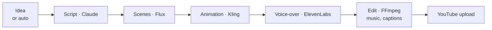

# What-if Shorts Pipeline

      

Automates vertical "What if…" concept trailers end to end.

## Details
- **Terminal UI** shows each stage live; type an idea or leave it empty for an automatic one
- API keys entered in the UI: saved to `.env` only if you tick *remember*, otherwise kept in memory for the session
- Royalty-free music picked at random from a local folder
- **Dry-run mode** renders the full edit with placeholder scenes — no paid API calls

---

> **Showcase repository.** This repo presents the project — what it does, how it is built and what it looks like.
> The full source code is private. For a walkthrough or a code sample, get in touch.

**Tural Zamanlı** · Data & Automation Developer · [Portfolio](https://dicapso.github.io) · [GitHub](https://github.com/Dicapso)
